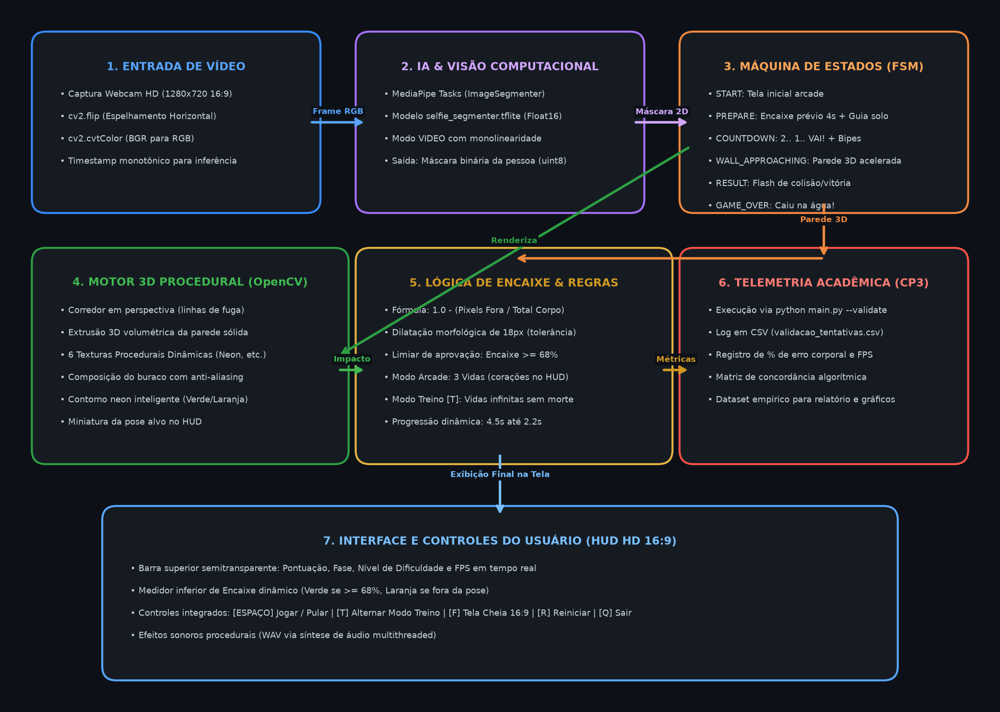
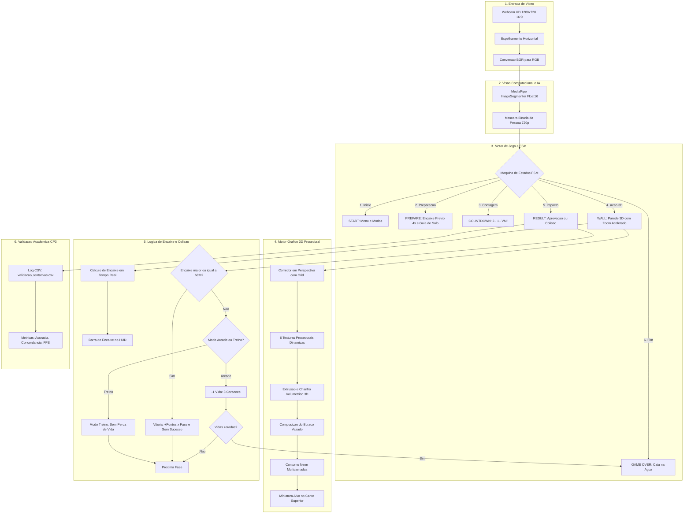

# Muro Humano 3D (Hole in the Wall)

> **Jogo em Tempo Real com Visão Computacional e Inteligência Artificial**  
> Projeto acadêmico para a disciplina de **Computação Cognitiva (CP3)** – **FIAP**  
> **Autor:** Luiz (RM 553529)

---

## 1. Descrição do Projeto

O **Muro Humano 3D** é uma releitura interativa em tempo real do famoso quadro televisivo *"Hole in the Wall"* (Muro do Faustão). Uma parede temática tridimensional avança em direção à tela com um buraco em formato de pose corporal; o jogador, posicionado em frente à sua webcam, precisa reproduzir fisicamente a silhueta humana correta para passar pelo vão sem colidir.

O sistema utiliza a biblioteca **MediaPipe** (Google Tasks API com modelo de rede neural profunda `selfie_segmenter.tflite` float16) para extrair a silhueta volumétrica do jogador quadro a quadro em resolução **Widescreen HD 16:9 (1280x720)**, medindo matematicamente a taxa de sobreposição (overlap / IoU) entre o corpo e o vão da parede.

---

## 2. Diagrama de Fluxo e Arquitetura do Sistema



<details>
<summary><b>Clique para expandir o código Mermaid do diagrama</b></summary>



</details>

---

## 3. Catálogo das 12 Fases e Progressão de Dificuldade

As 12 fases foram desenhadas a partir de silhuetas anatômicas humanas reais (geradas por IA e ajustadas com escala natural e pés apoiados na base da tela):

| Fase | Pose | Dificuldade | Tempo do Muro | Mecânica / Foco Motor |
|:---:|---|:---:|:---:|---|
| **01** | **Vitória** | **FÁCIL** | 4.5s | Braços abertos em V e postura ampla |
| **02** | **T-Pose Inclinada** | **FÁCIL** | 4.3s | Braços em cruz com inclinação do tronco |
| **03** | **Super-Herói** | **FÁCIL** | 4.1s | Mãos apoiadas na cintura e cotovelos abertos |
| **04** | **O Pensador** | **FÁCIL** | 3.9s | Mão no queixo e pernas firmes |
| **05** | **O Grito** | **MÉDIO** | 3.5s | Mãos espalmadas no rosto e pernas em zigue-zague |
| **06** | **Egípcio** | **MÉDIO** | 3.35s | Braços em ângulo reto estilo hieróglifo |
| **07** | **Disco Fever** | **MÉDIO** | 3.2s | Braço apontando para o céu na diagonal |
| **08** | **Surfista** | **MÉDIO** | 3.0s | Agachamento atlético baixo e base aberta |
| **09** | **O Diamante** | **DIFÍCIL** | 2.8s | Mãos unidas sobre a cabeça e pernas em plié |
| **10** | **Esquiva Matrix** | **DIFÍCIL** | 2.6s | Tronco torcido para trás com pernas dobradas |
| **11** | **Contorcionista** | **DIFÍCIL** | 2.4s | Braço passando sobre a cabeça e tronco curvo |
| **12** | **Karatê Kid** | **DIFÍCIL** | 2.2s | **Desafio Final**: Equilíbrio em uma perna só |

---

## 4. Mecânicas e Inovações Técnicas

### 4.1. Encaixe Prévio (Fase `PREPARE`)
Antes de cada aproximação do muro, o jogo concede **4 segundos de preparação**:
- A silhueta alvo é projetada em ciano transparente sobre a webcam do jogador.
- Uma linha guia de solo (`y = 714`) indica a posição ideal dos pés.
- O contorno do jogador acende em **verde** se o encaixe já estiver correto ($\ge 68\%$) ou **laranja** se houver partes fora.
- O jogador pode apertar **`[ESPAÇO]`** a qualquer momento para pular a preparação e iniciar a contagem imediatamente.

### 4.2. Renderizador 3D Procedural (OpenCV)
- **Túnel em Perspectiva:** Corredor com linhas de fuga e grid dinâmico avançando para o ponto focal.
- **Extrusão Volumétrica:** A parede não é uma imagem 2D plana — ela possui faces superiores, inferiores e laterais com sombreamento de profundidade e chanfro 3D.
- **Texturas Dinâmicas:** 6 temas procedurais animados matematicamente (`cyber_neon`, `wave`, `plasma`, `brick`, `electric`, `matrix_green`).
- **Contorno Neon Multicamadas:** 3 camadas de renderização para garantir nitidez mesmo a longas distâncias.
- **Miniatura Guia (Thumbnail):** Janela com a silhueta alvo fixa no canto superior direito para o jogador não perder a referência visual.

### 4.3. Cálculo Matemático de Encaixe
A aprovação do impacto calcula a fração de pixels da pessoa fora da máscara dilatada:

$$\text{Encaixe (\%)} = \left(1.0 - \frac{\sum (M_{\text{player}} = 255 \land M_{\text{stage}} = 0)}{\sum (M_{\text{player}} = 255)}\right) \times 100$$

- **Limiar de Aprovação:** $\ge 68\%$ de encaixe (tolerância de até 32% para fora).
- **Dilatação Anatômica:** A máscara do buraco conta com $18\text{px}$ de margem extra para compensar pequenas imperfeições de captura e roupas folgadas.

### 4.4. Modos de Jogo: Arcade vs. Treino
- **Modo Arcade (Padrão):** 3 vidas representadas por corações no HUD. Bater na parede custa uma vida; ao zerar, o jogador cai na água (*Game Over*).
- **Modo Treino (Vidas Infinitas):** Ativado com a tecla **`[T]`** ou `--treino`. Permite jogar e testar todas as 12 fases sem risco de Game Over, registrando pontuação contínua.

---

## 5. Como Instalar e Executar

### Pré-requisitos
- **Python 3.10+** (recomendado Python 3.11)
- Sistema Operacional: Windows 10/11 ou Linux/macOS
- Webcam conectada

### Passo 1: Clonar o Repositório e Criar Ambiente Virtual
```powershell
# Entrar na pasta do projeto
cd CP3_CognitiveComputing

# Criar ambiente virtual com uv ou python venv
uv venv
.\.venv\Scripts\activate

# Instalar dependências
uv pip install -r requirements.txt
```

### Passo 2: Executar o Jogo
Você pode executar diretamente via launcher ou linha de comando:

```powershell
# Execução direta com o Python do ambiente virtual
.\.venv\Scripts\python.exe main.py

# Iniciar direto no Modo Treino (Vidas Infinitas)
.\.venv\Scripts\python.exe main.py --treino

# Executar com validação de métricas acadêmicas (salva em CSV)
.\.venv\Scripts\python.exe main.py --validate
```

*(No Windows, você também pode simplesmente dar duplo clique em `jogar.bat` ou executar `.\jogar.ps1`).*

---

## 6. Controles durante o Jogo

| Tecla | Função |
|:---:|---|
| **`[ESPAÇO]`** | Iniciar o jogo / Avançar imediatamente a fase de preparação |
| **`[T]`** | Alternar entre **Modo Arcade (3 Vidas)** e **Modo Treino (Vidas Infinitas)** |
| **`[F]`** | Alternar entre modo Janela e **Tela Cheia (Fullscreen 16:9)** |
| **`[R]`** | Reiniciar a partida após o *Game Over* |
| **`[Q]`** ou **`[ESC]`** | Sair do jogo |

---

## 7. Módulo de Validação Acadêmica (CP3)

Para atender aos requisitos científicos e experimentais da disciplina de Computação Cognitiva, o projeto conta com um módulo de telemetria empírica:

```powershell
python main.py --validate
```

A cada impacto na parede, o sistema registra automaticamente no arquivo [`validacao_tentativas.csv`](file:///C:/Users/luizd/.gemini/antigravity/scratch/CP3_CognitiveComputing/validacao_tentativas.csv):
1. **ID da tentativa** e carimbo de data/hora;
2. **Fase e Pose testada**;
3. **Porcentagem do corpo fora do buraco**;
4. **Veredito do algoritmo** (*PASSOU* ou *CAIU*);
5. **Taxa de quadros por segundo (FPS médio)** mantida pela engine;
6. **Métrica de concordância observador-algoritmo** para matriz de confusão e cálculo de acurácia estatística.
